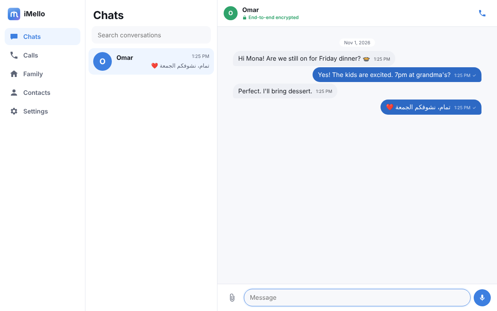
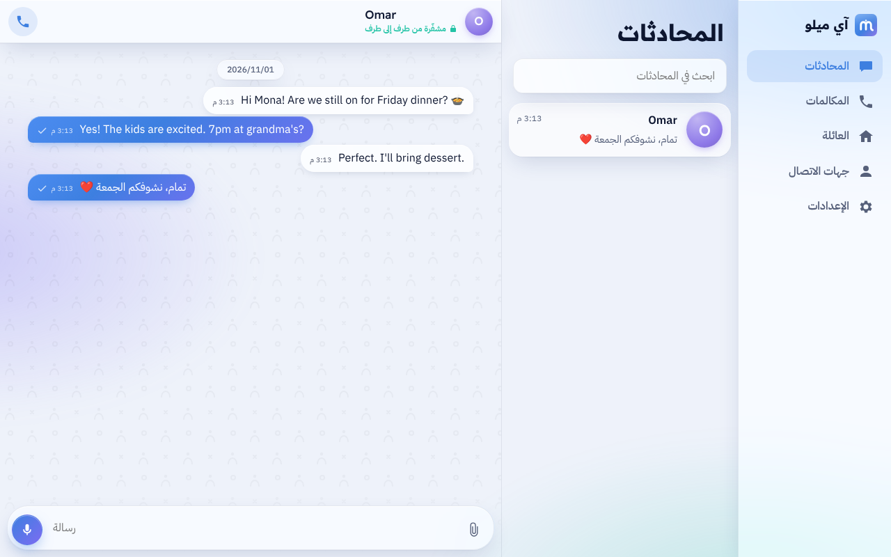

<p align="center">
  
</p>

<h1 align="center">iMello · آي ميلو</h1>
<p align="center"><b>Stay Close. Feel Connected.</b> — خلّك قريب من اللي تحبهم</p>
<p align="center">A private, ad-free, end-to-end encrypted messenger for families, children and trusted friends.<br/>Developed by abu00salman · v1.0.0 (development preview)</p>

---

> **Status:** development preview. Encrypted one-to-one messaging works on the **web client** and is verified by
> automated end-to-end tests against a real homeserver. Mobile apps have accounts, contacts and guardian controls but
> **not yet encrypted chat**. iMello has **not** had an independent security review. See
> [Known limitations](docs/KNOWN_LIMITATIONS.md).

<p align="center">
  
  
</p>
<p align="center">
  
</p>

## What works today

| | Web | iOS / Android (Expo) |
| --- | --- | --- |
| Register / sign in (no phone number needed) | ✅ | ✅ |
| Private invite links & QR codes (single-use, expiring) | ✅ | ✅ (share sheet) |
| **End-to-end encrypted one-to-one chat** (Matrix Megolm/Olm, Rust crypto) | ✅ | ⬜ next phase |
| Replies, typing indicator, delivery state, offline catch-up | ✅ | ⬜ |
| Family Spaces, child accounts, guardian approvals | ✅ | ✅ approvals |
| Server-enforced child safety (strangers cannot reach children) | ✅ | ✅ (server-side) |
| Kids Mode | ✅ home screen | ⬜ |
| Devices list & remote sign-out | ✅ | ⬜ |
| Temporary session for public computers | ✅ | – |
| English & Arabic (RTL), light / dark / system | ✅ | ✅ (restart for RTL) |
| Data export, account deletion | ✅ | ⬜ |

Not yet: media, voice messages, group chat UI, calls, push notifications, device verification UI — see the
[roadmap](docs/ROADMAP.md).

## Architecture in one paragraph

iMello is built on **Matrix**: a self-hosted **Synapse** homeserver (federation, open registration and user
directory all disabled) stores only encrypted messages. Clients encrypt with the audited Rust crypto stack
(vodozemac, via `matrix-js-sdk` + WASM on the web). A small **iMello Policy API** (TypeScript, Fastify, PostgreSQL)
owns accounts, contacts, invites, families and guardian rules, and a **Synapse module** asks it before every invite or
join — failing closed — so the rules hold even against a modified client. iMello implements no cryptography of its
own. Full reasoning and the Matrix-vs-custom comparison: [docs/ARCHITECTURE.md](docs/ARCHITECTURE.md).

```
apps/web        React + Vite web client          services/api    Policy API + SQL migrations
apps/mobile     Expo (Expo Router, EAS)          infrastructure  Synapse config + policy module, Docker template
packages/core   policy, validation, API client,  scripts         dev-stack.sh (Synapse + API without Docker)
                Matrix messaging wrapper         tests/e2e       protocol & browser end-to-end tests
packages/ui     design tokens                    docs            product, security, threat model, …
packages/localization  en / ar
```

## Quick start (local)

Requirements: Node 22+, pnpm 10, PostgreSQL 16, Python 3.10+ (for Synapse). macOS: `brew install node pnpm postgresql@16 python`.

```bash
pnpm install

# PostgreSQL: role imello/imello; databases imello, imello_test, and synapse (C collation)
createuser -s imello && psql -c "ALTER USER imello PASSWORD 'imello'"
createdb -O imello imello && createdb -O imello imello_test
createdb -O imello -E UTF8 --lc-collate=C --lc-ctype=C -T template0 synapse

# Synapse in a virtualenv
python3 -m venv ~/.venvs/synapse && ~/.venvs/synapse/bin/pip install matrix-synapse psycopg2-binary

# Start homeserver + policy API (generates local secrets in .dev-stack/, git-ignored)
SYNAPSE_PYTHON=~/.venvs/synapse/bin/python pnpm dev:stack

pnpm dev:web          # → http://localhost:5173  (open two browser profiles to chat)
pnpm dev:stack:stop
```

Mobile: `cd apps/mobile && pnpm start` (Expo dev server). Installable builds use EAS — see
[docs/DEPLOYMENT.md](docs/DEPLOYMENT.md#mobile-builds-eas--no-xcode-gui-required). No Xcode GUI required; an Apple
Developer account is required for any build that installs on a physical iPhone.

## Tests

```bash
pnpm lint && pnpm typecheck
pnpm test                                    # unit + API integration (needs PostgreSQL)
eval "$(bash scripts/dev-stack.sh env)"
pnpm test:e2e                                # real Synapse + API + Rust crypto
pnpm test:browser                            # production web build in Chromium, two browsers
```

Latest results (2026-11-01): lint ✅ · typecheck ✅ · 58 unit/API tests ✅ · 32 protocol E2E ✅ · 3 browser E2E ✅ ·
Android + iOS JS bundles compile ✅. Details: [docs/TESTING.md](docs/TESTING.md).

## Documentation

[Product](docs/PRODUCT.md) · [Architecture](docs/ARCHITECTURE.md) · [Security](docs/SECURITY.md) ·
[Threat model](docs/THREAT_MODEL.md) · [Roadmap](docs/ROADMAP.md) · [API](docs/API.md) · [Database](docs/DATABASE.md) ·
[Testing](docs/TESTING.md) · [Deployment & costs](docs/DEPLOYMENT.md) · [Privacy](docs/PRIVACY.md) ·
[Known limitations](docs/KNOWN_LIMITATIONS.md)

## Principles

No ads. No trackers. No strangers. No covert monitoring. No addictive feeds. Core safety features are always free.

---

© abu00salman. All rights reserved (licence to be decided). iMello uses open-source components including
Synapse (AGPL-3.0), matrix-js-sdk and matrix-sdk-crypto (Apache-2.0); see ARCHITECTURE.md §2 for licensing notes.
